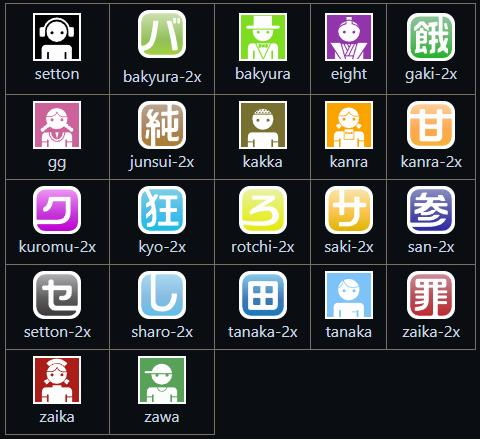

# drrr-MusicBot

一个用于 [drrr.com](https://drrr.com) 的 MusicBot，解决房间内vip音乐的播放问题。支持网易云源与 QQ 源，支持歌名搜索播放。

本项目基于 [stozn/drrr-bot](https://github.com/stozn/drrr-bot) 修改，主要修复了部分bug，增强了代码的健壮性，并新增了终端输入和部分模组。音乐实现基于
[GDstudio](https://music.gdstudio.org/)、[gequbao](https://www.gequbao.com/) 。

> ⚠️ 本项目仅供学习交流，音乐版权归原平台所有，请勿用于商业用途。

## 主要功能

### 🎵 音乐

| 命令                                                | 说明                   |
|-----------------------------------------------------|------------------------|
| /点歌 <链接> 、 /点歌 <歌名> 、 /点歌 <歌名>-<歌手> | 播放歌曲               |
| /队列                                               | 查看播放队列           |
| /随机播放                                           | 随机排序当前的播放队列 |
| /跳至 <序号>、/跳至 <歌名>                          | 下一首跳至队列对应曲目 |
| /清空                                               | 清空当前播放队列       |

### 📋 歌单

| 命令 | 说明 |
|------|------|
| /新增歌单 <歌单名> <url> | 保存音乐歌单 |
| /同步歌单 <歌单名> <url> | 用自己的新歌单覆盖同名歌单（仅创建者） |
| /删除歌单 <歌单名> | 删除自己的歌单（仅创建者） |
| /歌单列表 | 按创建者分组展示已存储歌单 |
| /播放歌单 <歌单名> | 播放自己或他人的歌单 |

### 💬 留言 / 聊天

| 命令 | 说明 |
|------|------|
| /留言 <对象> <内容> | 房间内发送为公开留言；私信 bot 为私密留言 |
| /chat on\|off | 开关 LLM 聊天（可调用点歌、队列、留言等命令） |

### 💡 其他

- 每 30 分钟整点报时一次
- 用户进房自动欢迎，欢迎曲可在 `modules/welcome.py` 中修改
- 终端直接输入文字即可在房间内发言
- 终端输入 `/quit`，或者房间内发送 `/quit`(要配置owner_tc)，可终止 bot
- 房间内发送`/help`可查看命令使用指南

## 快速开始

```
# 安装依赖（Python 3.10+）
pip install -r requirements.txt

# 启动 Bot
python -u main.py
```

## 常见问题以及注意事项❗❗

> **Q: 听不到声音，点歌成功但无声？**
>
> A: 请**关闭** drrr 设置中的「仅允许来自知名网站的音乐」。

> **Q:`/点歌`失败？**
>
> A: **命令与参数之间要有空格**（`/点歌 晴天`，不是 `/点歌晴天`）；并确认 `music_bot` 已加入 `mods`。

> **Q: 切歌混乱，音乐房自带的`/skip`无效？**
>
> A: 音乐房自带的歌曲指令和 bot 的歌曲指令**不要混用**。本 bot 的点歌走自己的队列，音乐房自带指令会打乱队列。

> **Q: 如何让bot退出房间?**
> 
> A: 在终端输入`/quit`并回车；在房间内输入`/quit`（需要填写owner_tc)；房主直接踢出bot

> **Q: 使用了`/跳至`命令但是没有立即切歌?**
> 
> A: 这是正常现象。为了避免短时间内大量切歌`/跳至`功能仅指定下一首播放的歌曲，不立即开始播放

## 配置

```
# 用户名
name = musicbot

# Tripcode（不用可留空）
tc = 

# bot所有者的tc(唯一），拥有/quit 退出权限
owner_tc =

# 头像名称
avatar = kyo-2x

# 房间ID
roomID = 

# 用户代理
agent = Bot

# 加载的模块（使用模块文件名，不含 .py 后缀）
mods = time_bot, welcome, music_bot, playlist, help, message_box

# 发送消息的等待时间（秒）
throttle = 1.2

# 全局限速：所有网络请求之间的最小间隔（秒）
qps = 0.5

# 房间管理员 Tripcode（加密后，逗号分隔，房间管理模块校验用）
admin_tc =

# ---- ChatBot 配置（不用可留空）----
llm_api_key =
llm_model = 
llm_api_url = 
```

## 用户代理

```
Desktop（桌面）
Mobile（手机）
Bot（机器人）
Tv（电视）
Tablet（平板）
```

## 头像



## 鸣谢 & 结语
感谢stozn的bot框架以及gdstudio-org的音乐网站👍👍

祝愿大家都能够享受音乐，享受生活！谢谢！o(*￣▽￣*)o（￣︶￣）↗　
